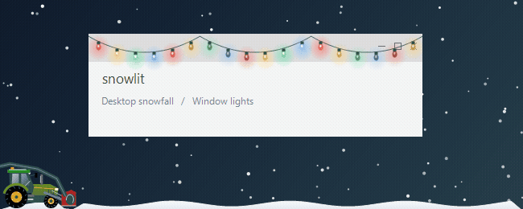

# snowlit

[Русский](README.md) · **English**

Snow for your Windows desktop. Flakes settle on window frames, string lights sway when you move a window, and a tractor loads snow into a tipper along the bottom of the screen.

[Download for Windows](https://github.com/kohb-git/Snowflake-on-Desktop/releases/latest) · [Changelog](CHANGELOG.md) · [Report an issue](https://github.com/kohb-git/Snowflake-on-Desktop/issues)

The animation uses the current snowlit renderer in a staged desktop scene. The [original QuietSnow concept video](docs/media/QuietSnow-demo.mp4) is a 19-second vertical MP4 with Russian captions.

## Getting started

1. Download the EXE under **Assets** in the latest release. Save it in a writable folder and launch it.
2. Right-click the snowflake in the notification area and choose **Настройки…** (Settings). The **Экраны** (Displays) tab lets you keep snow on one monitor and lights on another.
3. Double-click the tray icon to pause animation. To hide the effects temporarily, choose **Пауза на время** and select 30 minutes or two hours.

## Things to try

- **Move a window.** The light cord follows the frame while the bulbs sway. Adjust the offset and sag in the preview. Lights appear on non-maximized windows.
- **Let the snow build up.** After roughly two minutes with enough snow on the ground, a plow, a tractor with a tipper, and a car that can get stuck take turns crossing the screen.
- **Inspect your displays.** Choose **Проверить экраны…** for monitor coordinates, scaling, and effect status. Copy the report when filing a display issue.

## Updates

Choose **Проверить обновления…** (Check for updates) and confirm. Since version 1.1.1, snowlit verifies the download against the release asset’s SHA-256, replaces the executable in place, and restarts. **Что нового?** (What’s new?) opens the GitHub notes for the installed version.

[Build instructions, tests, and source history](docs/DEVELOPMENT.md)
