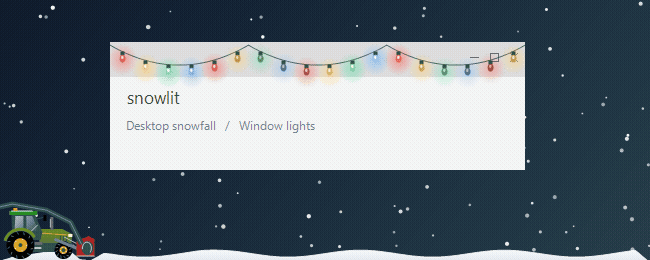

# snowlit

**Русский** · [English](README.en.md)

Снег для рабочего стола Windows. Снежинки оседают на рамах окон, гирлянды покачиваются при перемещении, а вдоль нижнего края экрана трактор загружает снег в самосвал.

[Скачать для Windows](https://github.com/kohb-git/Snowflake-on-Desktop/releases/latest) · [История изменений](CHANGELOG.md) · [Сообщить об ошибке](https://github.com/kohb-git/Snowflake-on-Desktop/issues)

Анимация выше отрисована движком snowlit на демонстрационной сцене. [Архивный ролик QuietSnow — MP4, 19 секунд](docs/media/QuietSnow-demo.mp4) показывает раннюю концепцию проекта.

## Начало работы

1. Скачайте EXE из раздела **Assets** последнего выпуска. Сохраните его в папке, доступной для записи, и запустите.
2. Щёлкните правой кнопкой по снежинке в области уведомлений и откройте **Настройки…**. Во вкладке **Экраны** можно оставить снег на одном мониторе, а гирлянды — на другом.
3. Двойной щелчок по снежинке ставит анимацию на паузу. Чтобы временно скрыть эффекты, выберите **Пауза на время** на 30 минут или 2 часа.

## Что попробовать

- **Переместите обычное окно.** Гирлянда следует за рамкой. Отступ и провисание регулируются в предпросмотре. На развёрнутых окнах гирлянда не появляется.
- **Дайте снегу накопиться.** Примерно через две минуты при достаточном количестве снега у нижнего края начинают по очереди появляться снегоуборщик, трактор с самосвалом и легковушка, которая может застрять в сугробе.
- **Откройте «Проверить экраны…».** Отчёт показывает координаты, масштаб и состояние эффектов на каждом экране. Его можно скопировать в сообщение об ошибке.

## Обновления

Выберите **Проверить обновления…** и подтвердите установку. Начиная с версии 1.1.1 приложение проверяет SHA-256 загруженного EXE, заменяет файл в прежней папке и перезапускается. **Что нового?** открывает описание установленной версии на GitHub.

[Сборка, тесты и происхождение исходников](docs/DEVELOPMENT.md)
